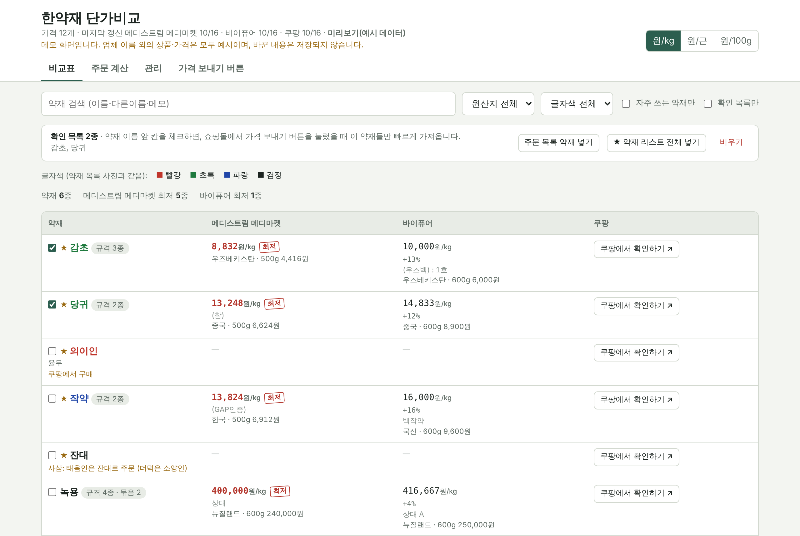
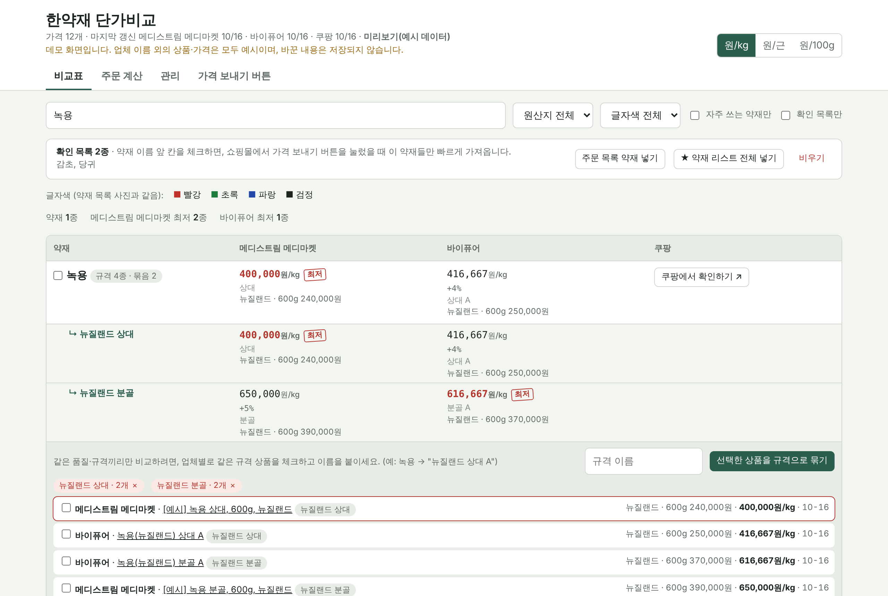
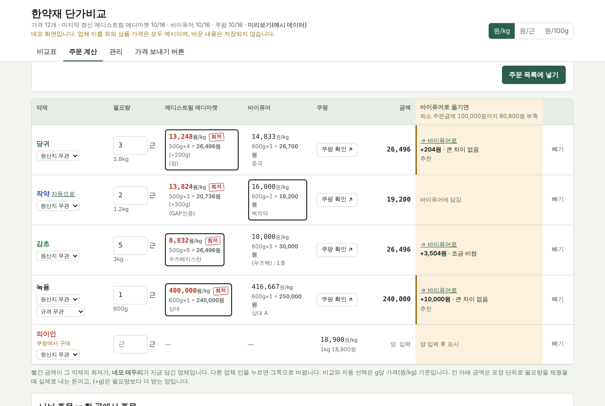
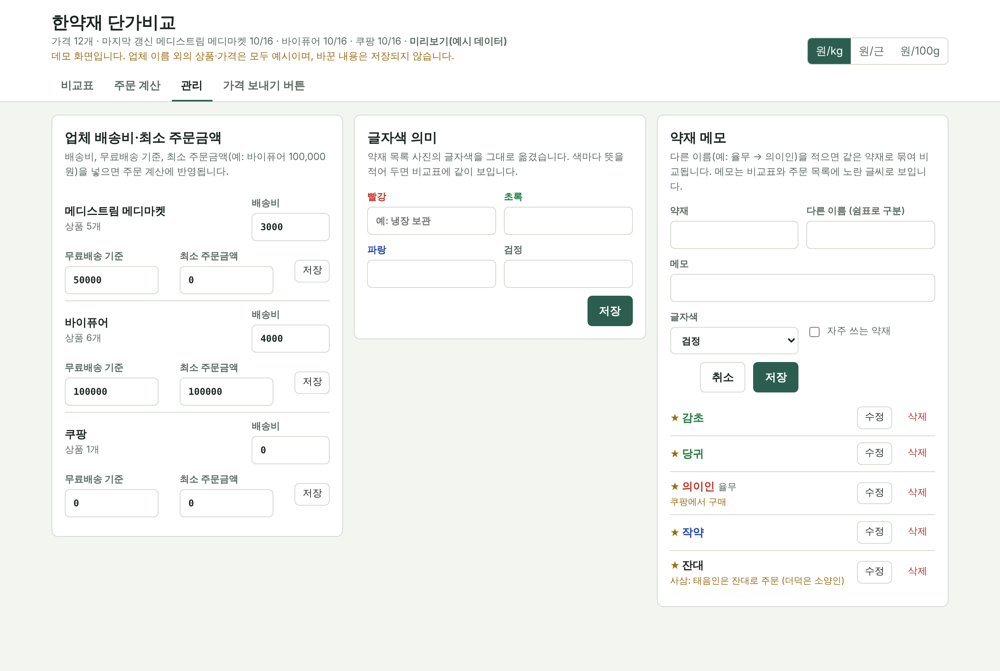

# 한약재 단가비교 — 한의원 약재 주문 도구

**▶ 데모 바로 써 보기: https://rosebaesj.github.io/herb-price-compare-showcase/**
(예시 데이터로 동작합니다. 실제 코드는 비공개 저장소에서 관리합니다.)

한의원에서 약재를 주문할 때마다 여러 도매 쇼핑몰을 하나씩 열어 가격을 확인하고,
500g·600g·1근처럼 제각각인 포장 단위를 손으로 환산하던 일을 줄이려고 만든 도구입니다.



## 해결한 문제

| 전에는 | 지금은 |
|---|---|
| 쇼핑몰 2~3곳을 하나씩 열어 약재마다 가격 확인 | 쇼핑몰에서 즐겨찾기 버튼 한 번 → 가격이 공유 시트로 자동 수집 |
| 500g / 600g / 1kg / 근 단위를 손으로 환산 | 모든 가격을 g당(원/kg) 기준으로 자동 환산해 최저가 표시 |
| 업체마다 다른 약재 이름 (내복자↔나복자, 괄루인↔과루인 …) | 한의원 약재 목록 309종에 업체 이름 40여 개를 연결 |
| 바이퓨어 최소 주문금액(10만원) 맞추기를 감으로 판단 | 옮겨도 손해가 적은 품목을 차이 금액과 함께 추천 |
| 주문 내용을 쇼핑몰 장바구니에 하나씩 다시 입력 | 확정한 주문을 버튼 한 번으로 장바구니에 담기 |

## 주요 기능

### 1. 업체별 가격 비교
- 약재마다 업체별 최저 단가(원/kg)와 최저가 표시, 오래된 가격은 노란색 경고
- 한 약재가 품질·규격별로 여러 상품일 때(예: 녹용 분골·상대·중대) **규격 묶음**으로 같은 등급끼리만 비교
- 가공품 구분(산조인 ↔ 산조인초, 우슬 ↔ 우슬주증), 한 목록에 섞여 파는 약재 분리(사삼 → 잔대/더덕)



### 2. 주문 계산
- 약재와 근 수를 한꺼번에 입력 (`당귀 3, 작약 2, 감초 5`)
- 업체별 칸을 눌러 담을 곳을 바꾸고, 포장 단위로 채웠을 때의 실제 결제액과 남는 양(+g) 표시
- 최소 주문금액 미달 시 오른쪽 칸에 "→ 바이퓨어로 +204원 · 큰 차이 없음" 형태로 추천



### 3. 관리
- 업체별 배송비·무료배송 기준·최소 주문금액
- 약재 메모(다른 이름, 주의 사항), 한의원 목록과 같은 글자색 표시



## 구조

```
쇼핑몰 화면 (로그인 상태)
   │  즐겨찾기 버튼(북마클릿) — 화면의 상품·가격 읽기 / 장바구니 담기
   ▼
Google Apps Script 웹 앱  ──  Google 스프레드시트 (가격·약재 메모·주문 목록)
   ▲
비교 사이트 (직원들이 링크로 접속, 로그인 불필요)
```

- **서버 비용 0원**: Google 스프레드시트 + Apps Script 웹 앱
- **설치 없음**: 확장 프로그램 대신 북마클릿 (윈도우·맥, 크롬·엣지·사파리)
- **기술**: Google Apps Script, 바닐라 JavaScript, HTML/CSS (라이브러리 없음)

## 데모에 대해

이 저장소의 `index.html`은 실제 비교 사이트 화면에 예시 데이터를 넣은 것입니다.
업체 이름 외의 상품명과 가격은 모두 예시이며, 화면에서 바꾼 내용은 저장되지 않습니다.
쇼핑몰 자동화 코드와 서버 코드는 포함하지 않았습니다.
